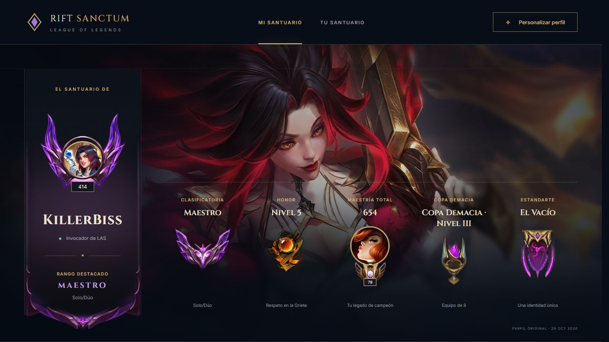

# Rift Sanctum

**Un santuario de League of Legends para explorar perfiles de LAS y personalizar su presentación.**

[](https://github.com/GermanBartoli/rift-sanctum)
[](https://github.com/GermanBartoli/rift-sanctum/actions/workflows/cloudflare.yml)

[Abrir sitio](https://rift-sanctum.pages.dev/) · [Empezar](#primeros-pasos) · [Mapa del repositorio](#mapa-del-repositorio) · [Autoría](#autoría-de-esta-documentación)



*Captura de la página publicada, tomada el 9 de noviembre de 2026. Conservada sin redimensionar ni recomprimir.*

## Primeros pasos

1. Abrí **Mi santuario** para ver el perfil original de referencia.
2. En **Tu santuario**, ingresá un Riot ID completo como `KillerBiss#2013` y pulsá Buscar.
3. Explorá los emblemas de rango y maestría y abrí Personalizar perfil. Los cambios de apariencia se guardan en este navegador y no modifican la cuenta de Riot.

## Referencia y detalles

**Tu identidad. Tu legado. Tu lugar en la Grieta.**

[Abrir Rift Sanctum](https://rift-sanctum.pages.dev/) · [Repositorio público](https://github.com/GermanBartoli/rift-sanctum)

Un santuario personal de League of Legends: el perfil de **KillerBiss**, sus logros y una colección para personalizar su apariencia. Construido con HTML, CSS y JavaScript, con animaciones nativas y sin dependencias de ejecución.

## Qué podés hacer

- Explorar el perfil original, de nivel 414, con el fondo **Miss Fortune T1 MVP** y su ícono firmado.
- Pasar el mouse por el rango para consultar las colas competitivas, victorias, PL y rango anterior. También admite clic, teclado y pantallas táctiles.
- Abrir las maestrías de Jarvan IV, Miss Fortune y Thresh y los eternos destacados.
- Cambiar el fondo, el ícono y el marco con búsqueda, filtros por campeón, paginación y vista previa.
- Guardar la apariencia en el navegador, cancelar una selección o restaurar el perfil original.

## Colección disponible

| Recursos                        | Cantidad en el catálogo inicial |
| ------------------------------- | ------------------------------: |
| Fondos de campeones y aspectos  |                           2.178 |
| Íconos con imagen disponible    |                           5.116 |
| Marcos de clasificación y nivel |                              31 |

El catálogo utiliza los recursos públicos de [CommunityDragon](https://communitydragon.org/documentation/assets), con nombres en español cuando están disponibles. Incluye los fondos con `splashPath`, las variantes publicadas en `questSkinInfo`, los íconos con imagen y los marcos de rango/nivel disponibles en las rutas utilizadas. No es una garantía de cobertura de recursos inéditos o exclusivos que la fuente no publique. Hay 86 entradas de íconos sin imagen en la fuente que no se ofrecen en el selector. Los chromas que no tienen ilustración propia no generan un fondo distinto.

Los recursos del perfil original se incluyen localmente. El resto de la colección se carga bajo demanda desde CommunityDragon. Si una miniatura falla, se muestra un marcador alternativo. Las fuentes tipográficas usan Google Fonts con alternativas locales.

## Ejecutar en tu computadora

Requiere **Node.js 22 o superior**. No hace falta instalar paquetes para ejecutar el proyecto.

```bash
pnpm run dev
```

Abrí `http://127.0.0.1:4173`. Para verificar y generar la versión publicable:

```bash
pnpm test
pnpm run build
```

El sitio terminado queda en `dist/`.

## Estructura

```text
public/
  index.html          Perfil, paneles y personalizador accesible
  styles.css          Diseño adaptable, animaciones y encuadre de recursos
  app.js              Interacciones, filtros y guardado local
  profile.js          Datos del perfil y funciones puras de validación
  data/catalog.json   Catálogo generado de recursos
  assets/             Arte original del juego para el perfil inicial
  favicon.svg         Identidad visual de Rift Sanctum
  _headers            Cabeceras para Cloudflare Pages
scripts/
  catalog.mjs         Actualiza el catálogo desde CommunityDragon
  build.mjs           Valida y prepara la publicación
  serve.mjs           Servidor local de desarrollo
tests/
  profile.test.js     Búsqueda, validación y valores de referencia
docs/
  arquitectura.md     Decisiones y próximos pasos
  verificaciones.md  Registro de las pruebas realizadas
```

## Actualizar el catálogo

```bash
pnpm run catalog
pnpm test
pnpm run build
```

El proceso necesita Internet y descarga recursos públicos, sin claves de Riot. La compilación habitual usa el catálogo versionado y no depende de descargarlo de nuevo. Revisá los cambios del JSON y los recursos antes de publicarlos.

## Alcance de esta versión

Los rangos, maestrías, honor y nivel de **Mi santuario** son una transcripción de las capturas del 29 de octubre de 2026; **no se sincronizan en tiempo real**. La personalización afecta la apariencia de este sitio y se guarda por navegador: no modifica el cliente de League of Legends ni la cuenta de Riot, y no se comparte todavía con otros visitantes.

La solapa **Tu Santuario** consulta Riot ID completos en LAS mediante `functions/api/player.js`. Requiere configurar `RIOT_API_KEY` como secreto de Cloudflare Pages. Sin esa clave, muestra conexión pendiente. Las sugerencias corresponden a las últimas cuentas consultadas en este navegador: Riot no ofrece búsqueda global por coincidencias parciales. El historial muestra las últimas cinco partidas al consultar; no se actualiza automáticamente. Honor, trofeos y estandartes no están disponibles en la API: se pueden completar manualmente desde el personalizador, sin presentarlos como datos verificados por Riot. Mi Santuario conserva sus datos de referencia y su personalización local.

## Publicación

Los pushes a `main` ejecutan pruebas, build y publicación en **Cloudflare Pages** mediante GitHub Actions. Requiere configurar secretos: ver [publicación automática](docs/despliegue.md).

## Autoría y recursos

Creado por **German Bartoli**, con **Codex** como colaborador de desarrollo. Los commits realizados con Codex incluyen `Co-authored-by: Codex <noreply@openai.com>`.

Rift Sanctum es un proyecto de fans independiente y no está afiliado ni respaldado por Riot Games. League of Legends, los personajes, las ilustraciones, los íconos y los emblemas pertenecen a Riot Games y conservan sus derechos originales. La publicación de este repositorio no concede derechos sobre esos recursos.

## Cambios de personalización

Honor, trofeos y estandartes se eligen desde el personalizador y se guardan junto con el fondo, icono y marco. Los marcos locales están recortados a su área visible. El inicio ocupa al menos la altura disponible de la ventana.

Para publicar con la sesión de Cloudflare autenticada: `pnpm dlx wrangler pages deploy dist --project-name rift-sanctum`. La carpeta `functions` debe permanecer junto a `dist` al ejecutar el comando.

## Perfiles consultados y personalización actual

Tu santuario reúne la guía de búsqueda, el perfil consultado y sus últimas partidas. Los emblemas de clasificatoria y maestría permiten explorar detalles. La apariencia se guarda por jugador en este navegador; cambiar fondo, ícono o marco no modifica Riot. Si parte del historial falla, el perfil y las partidas recuperadas se conservan y se informa la advertencia.


## Mapa del repositorio

- [package.json](<package.json>)
- [public/index.html](<public/index.html>)
- [docs/PUBLICACION.md](<docs/PUBLICACION.md>)
- [docs/arquitectura.md](<docs/arquitectura.md>)
- [docs/despliegue.md](<docs/despliegue.md>)

## Autoría de esta documentación

Repositorio mantenido por [Germán Bartoli](https://github.com/GermanBartoli). Guía revisada y actualizada con **Codex**, coautor de esta actualización documental. Los autores, colaboradores, licencias y recursos de terceros conservan sus créditos originales.

Los commits de esta revisión incluyen `Co-authored-by: Codex <noreply@openai.com>`; esta atribución no modifica la autoría del historial anterior.

<!-- firma-german-bartoli -->
<p align="center">
  <a href="https://germanbartoli.pages.dev/">
    <br />
    Hecho por Germán Bartoli · Ver portfolio
  </a>
</p>
